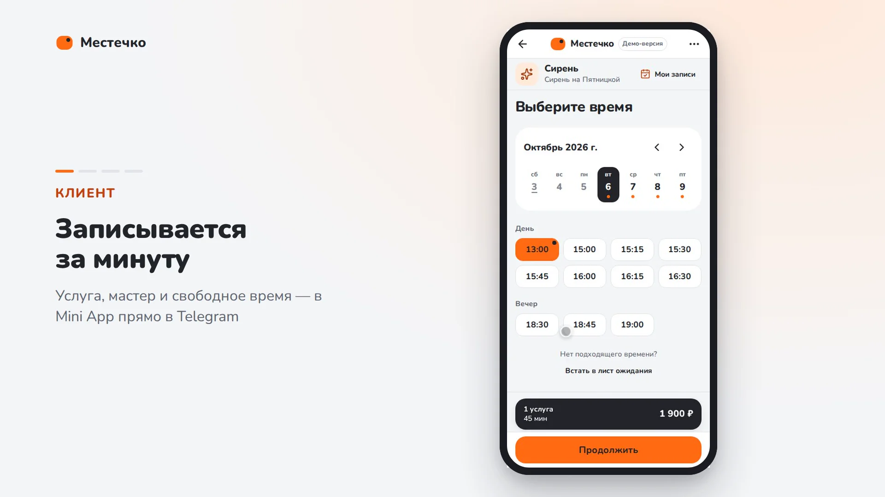
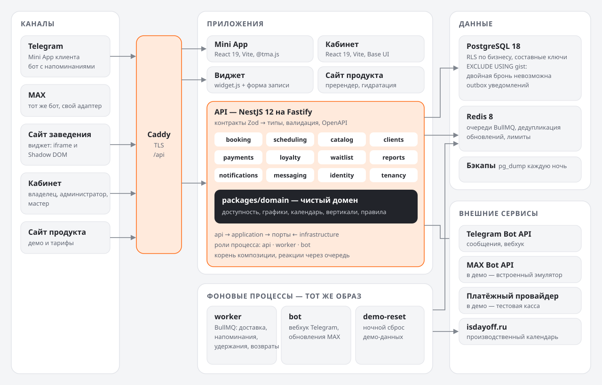
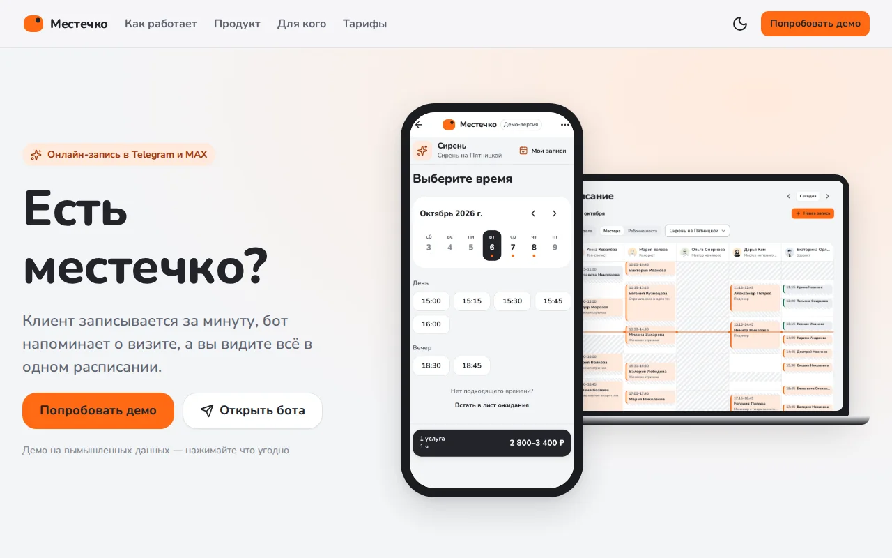
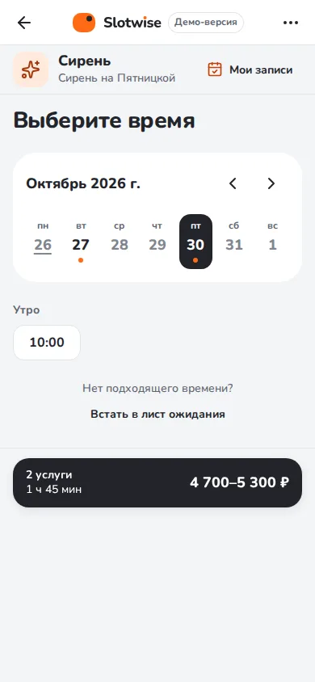
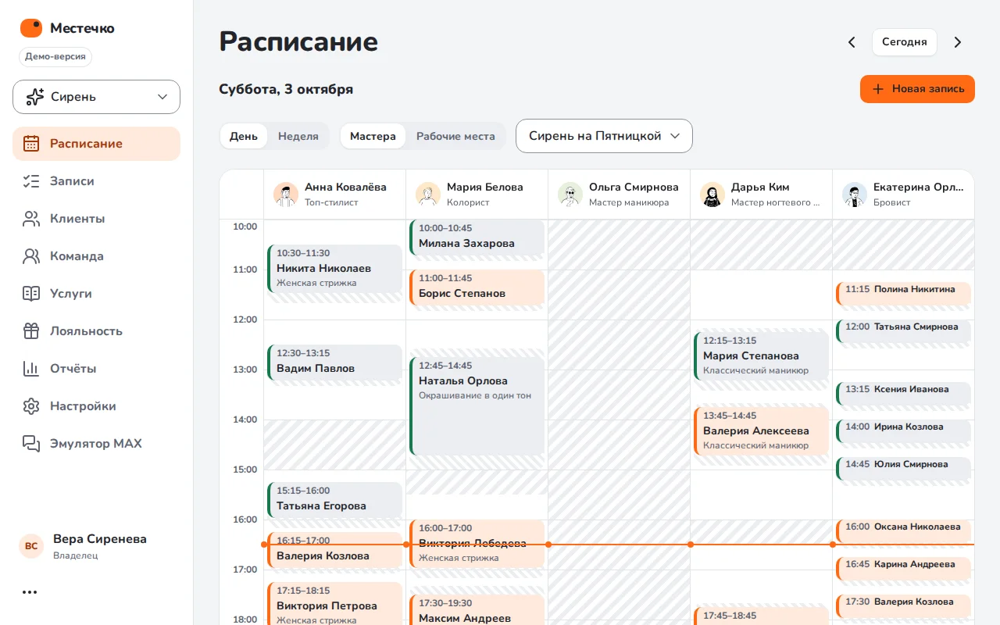
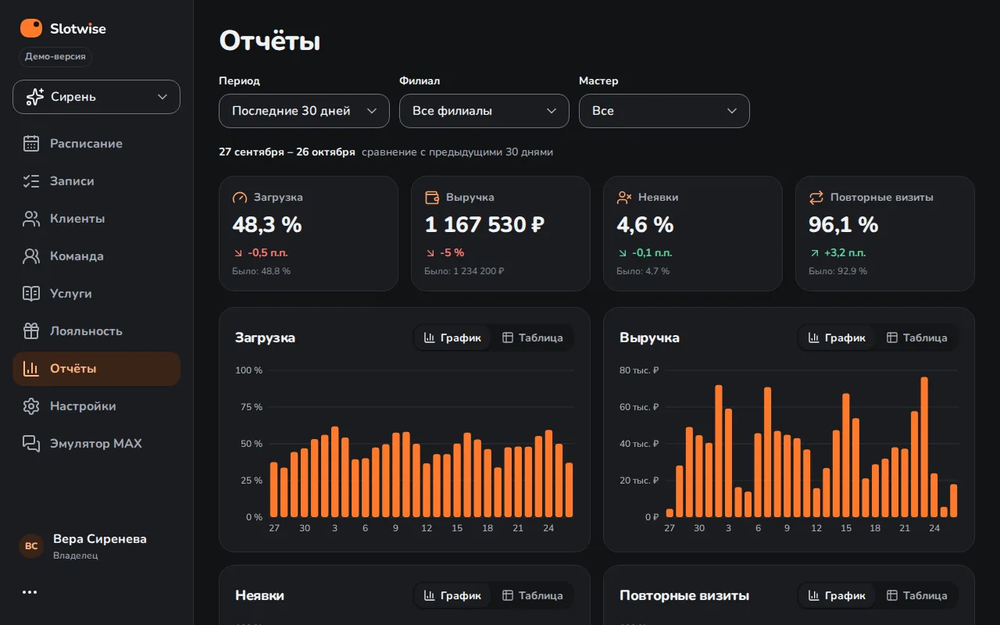
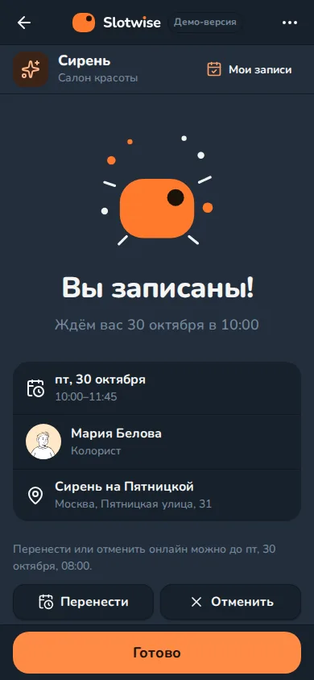
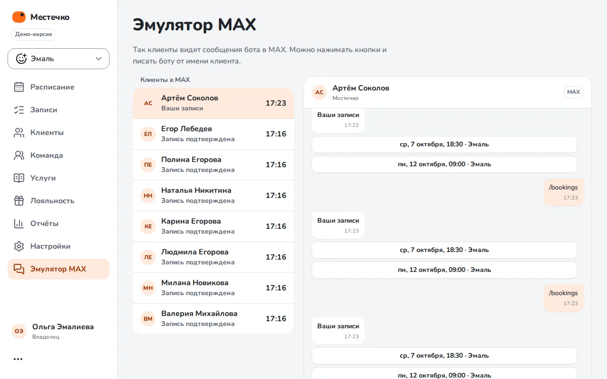
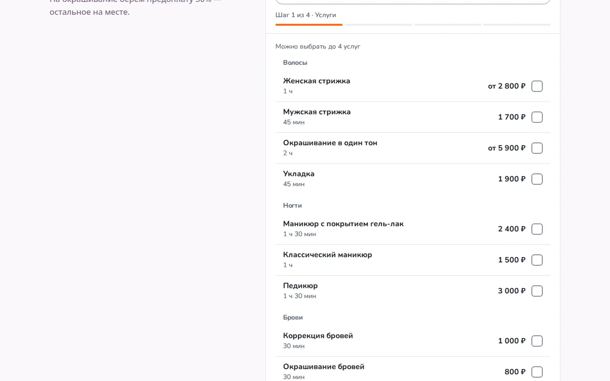
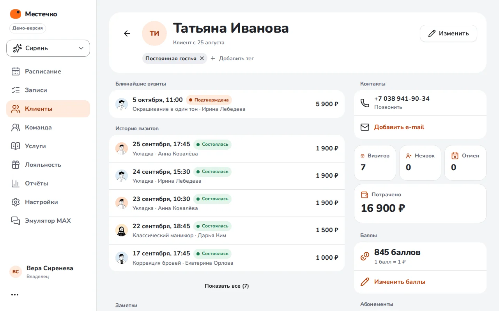

# «Местечко» — онлайн-запись в Telegram и MAX для малого бизнеса услуг

**TypeScript · React 19 · Vite 8 · NestJS 12 (Fastify) · PostgreSQL 18 · Redis 8 · BullMQ ·
Kysely · Zod · grammY · Telegram Mini Apps · Base UI · Docker · Caddy · Playwright · k6**

Фильм без звука, около минуты: [1920×1080](video/mestechko-1920x1080.mp4) ·
[1080×1920](video/mestechko-1080x1920.mp4). Клиент записывается в Mini App → запись
появляется в расписании кабинета → бот напоминает о визите → администратор переносит визит
перетаскиванием.

## Задача

Салоны, барбершопы, клиники и автосервисы записывают клиентов по телефону и в личных
сообщениях. Администратор отвечает вручную и держит расписание в голове или в таблице,
клиенты забывают о визитах, освободившееся время пропадает, случаются двойные записи.

Мы делали продукт, который снимает с заведения эту рутину:

- клиент записывается сам и там, где уже общается: в Telegram, в MAX, на сайте заведения;
- напоминания, перенос и отмена работают без участия администратора;
- у заведения один кабинет: расписание команды, клиенты, лояльность, предоплата, отчёты;
- одна платформа для разных видов бизнеса — со своими словами, услугами и правилами.

Ограничения, от которых зависела архитектура: одно время — одна запись при любой
конкуренции; часовые пояса, переходы на летнее время и производственный календарь РФ;
данные заведений полностью изолированы друг от друга; предоплата держит время, пока клиент
платит; бот пишет только тем, кто сам начал с ним диалог.

## Решение

**Для клиента**

- Mini App в Telegram: услуги, мастер или «любой мастер», свободное время по дням,
  подтверждение, «Мои записи», перенос, отмена, лист ожидания. Интерфейс следует теме
  Telegram, кнопки — нативные кнопки Telegram.
- Бот в Telegram и MAX: подтверждение записи, напоминания за сутки и за два часа, «Приду»,
  перенос и отмена кнопками, предложение освободившегося времени из листа ожидания.
- Виджет для сайта заведения одной строкой кода: в блоке страницы или кнопкой с окном,
  светлая и тёмная тема, стили сайта и виджета не смешиваются.
- Предоплата для дорогих услуг: время удерживается, пока клиент платит; не оплатил — время
  освобождается само.

**Для заведения**

- Расписание по мастерам и рабочим местам: день и неделя, запись с ресепшена, перенос
  перетаскиванием с отменой в один клик; клиент получает одно уведомление о новом времени.
- Команда и графики: смены 2/2, исключения на даты, отпуска, производственный календарь.
- Каталог, персональные цены мастеров, несовместимые услуги; клиенты с заметками, тегами,
  историей и импортом; баллы и абонементы; отчёты по загрузке, выручке, неявкам и повторным
  визитам; роли владельца, администратора и мастера.

**Платформа**

- Вертикали — записи реестра: салон, барбершоп, стоматология, автосервис. Новая вертикаль —
  одна запись и переводы, без правки кода.
- Демо-режим на вымышленных данных: вход в кабинет в один клик, эмуляторы запуска Telegram,
  бота MAX и платёжного провайдера, ночной сброс демо к исходному состоянию.
- Сайт продукта с настоящими экранами и короткими роликами из приложений.

## Результат

- **Готовый продукт из пяти частей**: Mini App, бот (Telegram и MAX), виджет, кабинет, сайт
  продукта. Демо — четыре заведения в четырёх городах, около 3 100 записей: восемь недель истории
  и три недели вперёд, с сезонностью по дням недели, праздниками и разной загрузкой мастеров.
- **Под нагрузкой** (продакшен-сборка, API на одном vCPU): подбор свободного времени —
  100 запросов/с с p95 45 мс; «Мои записи» — p95 5 мс; сто клиентов, одновременно
  нажимающих «Записаться» на одно окно, получают ровно одну запись и 99 вежливых отказов.
  Двойных броней — ноль ([performance.md](../performance.md)).
- **Нагрузочный тест нашёл и помог исправить две проблемы** ещё до выкатки: подбор слотов
  ускорен почти в 60 раз по p95 на 50 запросах/с, а взаимные блокировки при гонке за одно время
  больше не превращаются в ошибку 500.
- **Готово к выкатке**: шесть Docker-образов, стек `docker-compose.prod.yml` с
  автоматическим TLS, миграциями при выкатке, ночными резервными копиями и ротацией логов;
  пошаговая инструкция для чистого Ubuntu ([deploy.md](../deploy.md)). Весь стек проверен
  локально целиком.
- **Качество закреплено в CI**: гейты размеров файлов и папок, только токены дизайн-системы
  в стилях, строгий типизированный линт с границами слоёв, юнит- и интеграционные тесты на
  PostgreSQL и Redis, сверка типов БД со схемой, сборка всех продакшен-образов; скриншоты
  каждого экрана на трёх ширинах в светлой, тёмной и Telegram-теме.

## Архитектура

Монорепозиторий pnpm. Домен (`packages/domain`) — чистый TypeScript без фреймворков и базы:
движок доступности, графики, календарь, вертикали, правила записи. API — модульный монолит
на NestJS со слоями `api → application → порты ← infrastructure` и корнем композиции;
реакции между модулями (уведомить клиента, предложить освободившееся время, вернуть
предоплату) идут через очередь. Один образ API работает в трёх ролях: HTTP, фоновые задачи,
боты. Фронтенды — статические сборки Vite с общей дизайн-системой; контракты API — схемы
Zod, из которых выводятся типы, валидация и OpenAPI.

## Ключевые решения

1. **Двойная бронь невозможна в базе, а не в коде.** Время записи — `tstzrange` с
   exclusion-ограничениями по мастеру и по ресурсу. Приложение планирует, база решает:
   проигравший гонку откатывает только свою точку сохранения и пробует следующего мастера.
   Взаимная блокировка двух писателей — тоже проигранная гонка, а не ошибка.
2. **Движок доступности — чистая функция.** Графики, перерывы, буферы, комбинации услуг,
   ресурсы, часовые пояса и переходы на летнее время, производственный календарь — на входе
   данные, на выходе свободные старты. Его легко тестировать и легко ускорять: профиль под
   нагрузкой показал, где он тратил время.
3. **Мультитенантность в два слоя.** Составные ключи `(business_id, id)` не дают подставить
   чужой идентификатор, row-level security в PostgreSQL проверяет каждое чтение и запись,
   приложение подключается ролью без обхода RLS.
4. **Сообщения — outbox в той же транзакции.** Изменение записи и план уведомлений
   фиксируются вместе. Перенос в кабинете «отстаивается» минуту: если администратор вернул
   визит обратно, клиент не получит ни одного лишнего сообщения.
5. **Один код для Telegram и демо.** Mini App вызывает только API SDK Telegram; эмулятор
   перехватывает эти вызовы и рисует интерфейс Telegram. Бот MAX работает с эмулятором MAX
   Bot API через тот же адаптер, что и с настоящим MAX.
6. **Возможности — данными, а не условиями.** Вертикали, статусы, роли, виды уведомлений,
   тарифы, способ показа страницы оплаты у провайдера — реестры. Новый вариант добавляется
   записью, без `if` по названию.
7. **Контракты как источник правды.** Схемы Zod дают серверу валидацию и сериализацию,
   клиентам — типы и лёгкий манифест маршрутов без Zod в браузерном бандле; гейт проверяет,
   что OpenAPI актуален.
8. **Продакшен без компромиссов по безопасности.** Непривилегированные пользователи во всех
   образах, проверки здоровья у каждого процесса (у фоновых — файл-пульс), внутренняя сеть
   данных без выхода наружу, секреты только у тех сервисов, которым они нужны, вебхук
   Telegram с секретом.

## Экраны

|                                                                                        |                                                                                   |
| -------------------------------------------------------------------------------------- | --------------------------------------------------------------------------------- |
|  Сайт продукта                          |  Mini App: выбор времени |
|  Кабинет: расписание          |  Отчёты, тёмная тема     |
|  Mini App в теме Telegram |  Бот в эмуляторе MAX                 |
|  Виджет на сайте салона                |  Карточка клиента             |

Все экраны на трёх ширинах и во всех темах — в [docs/screenshots/m4](../screenshots/m4).

## Тексты для карточки

- Короткий (до 300 символов) и полный (до 1500) — в [card.md](card.md).
